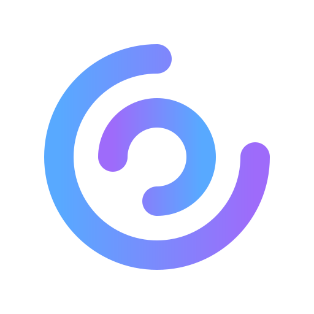

<div align="center">
  <picture>
    <source media="(prefers-color-scheme: light)" srcset="assets/logo-dark.svg" />
    
  </picture>

  <h1>arc</h1>

  <p><strong>A modern, open-source 3D modeling application.</strong></p>

  <p>
    <a href="#credits"></a>
    <a href="https://remgr12.github.io/arc/"></a>
    <a href="https://github.com/Remgr12/arc/releases"></a>
    <a href="#license"></a>
  </p>
</div>

arc is a multi-platform 3D modeling application built around a mesh-based geometry kernel written in Rust. It features a modern and intuitive interface for general design, architecture, and interior design workflows.

## Features

- **Primitive modeling** - box, sphere, cylinder, cone, torus, and plane primitives with editable parameters
- **Sketch tools** - circle, line, polyline, rectangle, dimension, and wall drawing on the ground plane with grid snapping
- **Solid generation** - extrude, revolve, sweep, and loft profiles into solids
- **Architecture tools** - walls, stairs, slabs, roofs, columns, beams, doors, and windows
- **Layers** - visibility, locking, colors, and per-entity overrides
- **Themes** - built-in color themes, plus import/export of custom themes from simple JSON color files
- **Keybind profiles** - multiple keyboard layouts with per-action rebinding, stored as named profiles
- **Undo and redo** - full command history with every editing operation
- **Multi-document** - work on several documents at once with live switching
- **Plugin system** - extend functionality with Lua scripts
- **File formats** - native `.arc` (JSON) documents plus OBJ and binary STL export
- **Cross-platform** - native desktop apps for Windows, macOS, and Linux

## Technology Stack

| Layer | Technology |
|-------|-----------|
| Kernel | Rust (`crates/arc-core`) - mesh generation, raycast picking, documents, history |
| Backend | Rust + Tauri 2 |
| Frontend | React 19 + TypeScript 7 + Vite 8 |
| Styling | Tailwind CSS 4 |
| State | Zustand 5 |
| Rendering | three.js (WebGL) |
| Icons | lucide-react |
| Plugins | Lua (mlua) |

## Project Structure

```
arc/
├── assets/                # Brand assets: logo + icon SVG sources, social banner
├── Cargo.toml             # Rust workspace configuration
├── crates/
│   └── arc-core/          # Geometry kernel: mesh generation, entity and document model,
│                          #   layers, selection, history, winding, raycast picking
├── src-tauri/             # Tauri application
│   ├── src/               # Commands, app state, plugin runtime
│   ├── plugins/           # Lua plugin directory
│   ├── tauri.conf.json    # Tauri app configuration
│   └── icons/             # App icons (regenerate with scripts/gen_icons.py)
├── frontend/
│   ├── src/
│   │   ├── App.tsx         # Root layout
│   │   ├── main.tsx        # Entry point
│   │   ├── lib/            # Store, IPC bindings, events, actions, keybinds
│   │   ├── data/tools.ts   # Tool definitions and default geometry
│   │   └── components/     # Viewport (three.js), panels, dialogs, Logo
│   ├── vite.config.ts
│   └── tsconfig.json
├── site/                  # GitHub Pages website (deployed by .github/workflows/pages.yml)
└── scripts/               # build.sh, release.sh, gen_icons.py
```

## Keybinds

| Keys | Action |
|------|--------|
| `V`, `M` | Select and move tools |
| `B` `Y` `C` `O` `T` `P` | Box, sphere, cylinder, cone, torus, plane |
| `G` `L` `J` `R` `D` `H` | Circle, line, polyline, rectangle, dimension, wall |
| `Ctrl K` | Command palette |
| `Ctrl Z`, `Ctrl Shift Z` | Undo and redo |
| `Ctrl N`, `Ctrl O`, `Ctrl S`, `Ctrl E` | New, open, save, export |
| `Ctrl A`, `Ctrl D` | Select all, duplicate |
| `Delete` | Delete selection |
| `F` | Fit view to selection |
| `Esc` | Clear selection and close menus |

Navigation: middle-drag orbits, right-drag pans, wheel zooms. Double-click an entity to zoom to it.

The view cube in the top-right corner of the viewport mirrors the camera orientation: hover and click a face to focus that plane (top, bottom, front, back, left, right), or drag it to orbit. All keybinds above live in the default "Classic" profile - create and edit custom profiles under Settings > Keyboard, and switch or import themes under Settings > Appearance.

## Building

### Prerequisites

- Rust toolchain (rustup)
- Node.js 20+ and npm

### Development

```bash
git clone https://github.com/Remgr12/arc.git
cd arc

# Install frontend dependencies
cd frontend
npm install
cd ..

# Run the app in development mode
cargo tauri dev
```

### Production build

```bash
# Build the frontend first (the bundler does not run it for you)
cd frontend
npm run build
cd ..

cargo tauri build
```

For platform matrix builds use `scripts/build.sh`, push a tag for CI (`scripts/release.sh`), or build the Flatpak manifest in the `flatpak` directory.

### Regenerating icons and brand assets

All raster art (app icons, `.ico`, `.icns`, Flatpak hicolor set, web favicons, social banner) is derived from the SVG sources in the `assets` directory. After changing the brand, run:

```bash
python3 scripts/gen_icons.py   # requires Pillow
```

## License

Dual-licensed under MIT or Apache-2.0, at your option:

- [LICENSE-MIT](LICENSE-MIT)
- [LICENSE-APACHE](LICENSE-APACHE)

## Links

- [Website](https://remgr12.github.io/arc/)
- [GitHub Releases](https://github.com/Remgr12/arc/releases)
- [Flatpak repository](https://remgr12.github.io/arc/flatpak-repo) - add it with `flatpak remote-add arc https://remgr12.github.io/arc/flatpak-repo`
- [Tauri Documentation](https://tauri.app)
- [three.js](https://threejs.org)
- [Shapr3D](https://www.shapr3d.com/) (UI inspiration)
